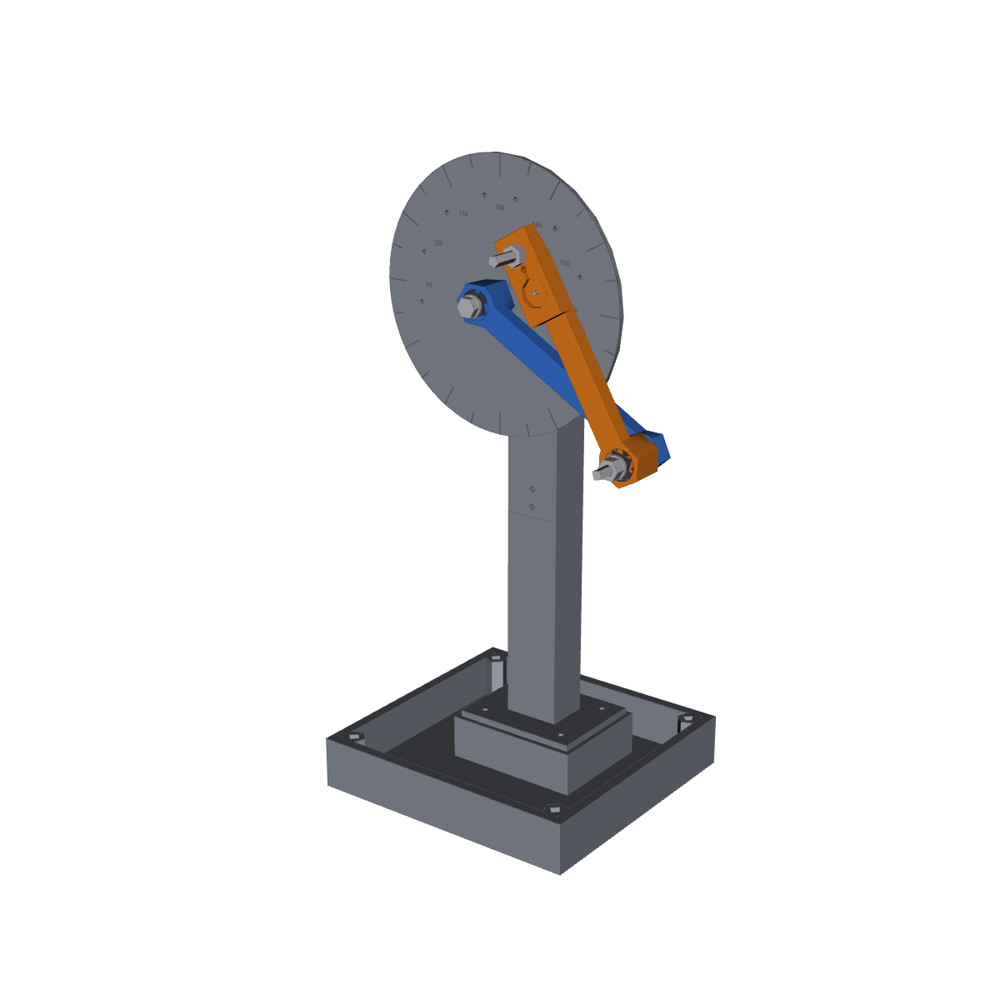
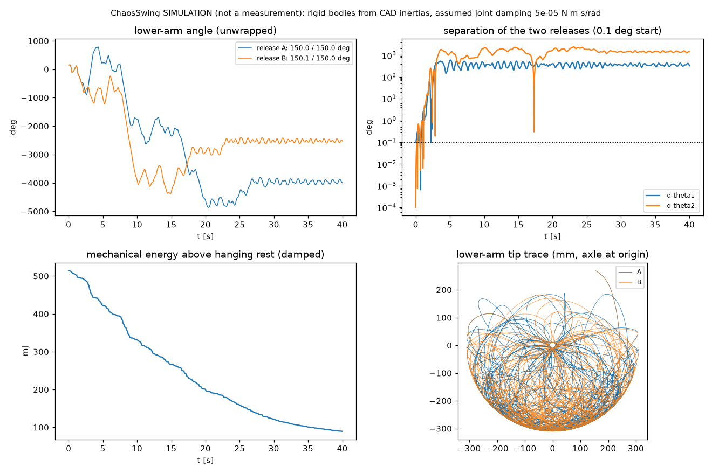
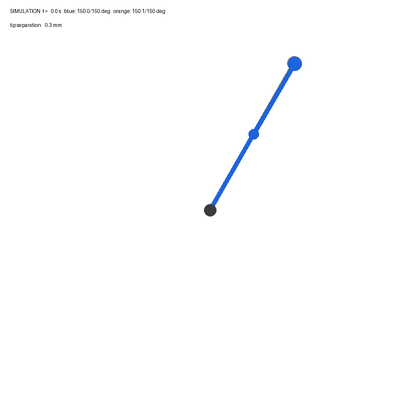

# ChaosSwing

A desktop **chaotic double pendulum** you can print on a normal FDM printer (220 x 220 x 250 mm bed) with cheap standard hardware (608 skate bearings, M8 and M5 bolts).
Release it from a big angle and it tumbles unpredictably. Release it twice from almost the same angle and the two runs end up completely different.

*Render of the CAD model (not a photo; nothing has been printed yet). Blue = upper arm (160 mm), orange = lower arm (150 mm) with the optional LED tip cap, grey = stand.*

| | |
|---|---|
| Upper arm | 160 mm pivot to pivot, 2x 608ZZ in the hub (10 mm apart), M8 elbow bolt |
| Lower arm | 150 mm pivot to tip, 2x 608ZZ, M8 tip bolt with nuts (about 32 g tip mass, adjustable) |
| Stand | base with a ballast pocket, 2-part bolted upright, 36 mm cantilever to the axle, axle 345 mm above the base top |
| Extras | 360 degree release ring with pin holes at 90/120/150/180 degrees, LED + CR2032 tip cap, 608 bearing test coupon |
| Software | parametric CadQuery source, checks, and a rigid-body simulation that uses the CAD masses and inertias |

Status: **v1, designed and checked on the computer only. Nothing has been printed or measured.** Everything marked *(unverified)* below is an engineering estimate.

## Simulation (not a measurement)

Two simulated releases, upper arm 150.0 and 150.1 degrees, lower arm in line, both from rest (rigid bodies with the inertias from the CAD, viscous joint damping of 5e-5 N m s/rad per joint as an **assumption**).
The tips are 10 mm apart after about 1.4 s and 100 mm apart after 1.8 s. More: `img/tip_trace.png`, `data/sim_summary.json`.

The simulation uses **viscous** damping. Real 608 bearing friction is partly Coulomb (constant torque), which most likely shortens the motion compared with the numbers here.

How long the motion stays wild depends almost entirely on the (unknown) friction. In the simulation the last flip of the lower arm happens after 12.8 s with 5e-5, after 64 s with 2e-5, after 11.9 s with 1e-4 and after 5.3 s with 2e-4 N m s/rad.
These are single trajectories of a chaotic system, so they are indicative only. **The 20-30 s goal is not confirmed; real run time is not measured (unverified).** Plainly: reaching 20-30 s of wild motion needs a joint damping of about 2-3e-5 N m s/rad or lower, which means low-friction bearings (degreased and lightly oiled, or ceramic). Standard greased 608 bearings are likely to give less. More tip mass also helps (lower/upper mass ratio up to about 0.95). Print the bearing test coupon and the arms first and time a run.

## Parts

Printable parts (STEP in `step/`, STL in `stl/`, both already in print orientation; assembly in `step/assembly.step`):

| Part | Qty | Bed footprint / height (mm) | Material | Supports |
|---|---|---|---|---|
| `base` | 1 | 218 x 210 x 40 | PLA or PETG | none |
| `upright_lower` | 1 | 100 x 80 x 200 | PLA or PETG | none |
| `upright_top` (with the cantilever axle mount) | 1 | 44 x 73.5 x 193 | PLA or PETG | none (printed upside down) |
| `release_ring` | 1 | 200 x 200 x 4 | PLA | none |
| `release_pin` | 2 | 8 x 8 x 27 | PLA | none |
| `upper_arm` | 1 | 32 x 190 x 24 | PLA | none (front face on the bed) |
| `lower_arm` | 1 | 32 x 177 x 24 | PLA | none (front face on the bed) |
| `tip_cap_led` (optional) | 1 | 28 x 60 x 10 | PLA | none |
| `spacers` (6 tubes: 2x 10 mm, 4x 4 mm) | 1 | 44 x 28 x 10 | PLA, 100 % infill | none |
| `bearing_test_coupon` | 1 | 100 x 34 x 7 | PLA | none |

Axial layout (distance `a` in front of the upright face): nose 0-36, release ring 36-40, upper hub 44-68, lower hub 72-96, tip nuts 96 and up. Every plane is at least 4 mm from its neighbour (spec: 3 mm), so both arms turn a full 360 degrees.

## Bill of materials (prices are rough estimates, not quotes)

| Item | Qty | Estimate |
|---|---|---|
| 608ZZ bearings (8 x 22 x 7) | 4 (+2 spare) | 6-12 EUR per 10 pack |
| M8 x 60 bolt, partly threaded (main axle) | 1 | 0.5 EUR |
| M8 x 60 bolt, partly threaded (elbow) | 1 | 0.5 EUR |
| M8 x 40 bolt (tip mass) | 1 | 0.5 EUR |
| M8 hex nuts (1 axle, 2 tip, more for tuning) | 4-8 | 1 EUR |
| M8 nyloc nut | 1 | 0.3 EUR |
| M8 washers | 2 (+ spare) | 0.3 EUR |
| M5 x 45 bolts + M5 nuts (upright to base) | 4 + 4 | 1 EUR |
| M5 x 40 bolts + M5 nuts (upright splice) | 2 + 2 | 0.5 EUR |
| Desk screws or clamps for the 4 base holes (M5 clearance 5.5 mm, head recess 10.4 mm) | 4 | 1 EUR |
| Ballast: steel washers/nuts about 3 kg (required for releases above 90 degrees) or 1 kg of sand (only for swings up to 90 degrees) | 1 | 6-10 EUR |
| Desk screws or a clamp (required for releases above 90 degrees) | 1 set | 1-5 EUR |
| PLA filament, about 1.1 kg (assumed infill, see below) | 1 | about 22 EUR at 20 EUR/kg |
| Optional: 5 mm LED, CR2032 + cell, small switch | 1 | 2 EUR |
| **Total** | | **roughly 40-55 EUR (estimate)** |

## Print settings

- 0.4 mm nozzle, 0.2 mm layers, PLA. PETG is fine for the base and upright if you prefer it.
- Arms: 4 perimeters, 5 top/bottom layers, 25-30 % gyroid. Print them front face down (the STL is already oriented that way) so the bearing seats are vertical and round.
- Base, uprights, ring: 3-4 perimeters, 15-30 % infill. The base and uprights are mostly there to be stiff, not light.
- Spacers: 100 % infill. Pins: 100 % infill.
- No supports are needed. The upright top is printed upside down on its flat top face. The first layer over the hex pockets and bearing steps bridges a few millimetres.
- **Print the bearing test coupon first.** Seats are 21.9 / 22.1 / 22.3 mm. If you want a tighter or looser fit, change `SEAT_D` in `cad/params.py`, rebuild, and reprint the two arms. The default 22.1 mm is a guess for a typical printer (unverified).
- Tolerances used: M8 clearance 8.4 mm, M5 5.4 mm, nut traps +0.2 mm across flats, sliding fits +0.25 mm.

## Assembly (steps are untested on a real print)

1. Print everything. Check the coupon: a 608 should press in by hand or in a vise and stay put. Pick the seat size you like and update `SEAT_D` if needed.
2. **Degrease the bearings** (isopropanol or a solvent bath, dry, then one drop of light oil). Factory grease makes them sluggish, and friction decides how long the pendulum keeps moving.
3. Base: fit 4 M5 nuts in the hex pockets on the underside. Screw `upright_lower` on with 4 M5 x 45 bolts (heads on the flange). Do not fill the ballast pocket yet.
4. Splice: plug the spigot of `upright_lower` into the socket of `upright_top`. Push 2 M5 x 40 bolts through from the front, with the nuts in the hex traps at the back. Check that the nose points to the front.
5. Axle nut: slide one M8 nut into the slot in the nose from the top (the slot is open at the top).
6. Release ring: put it on the four pegs on the nose front face.
7. Upper arm: press a bearing into each seat of the hub. Between them put the 10 mm spacer (insert it after the first bearing). The head of the M8 x 60 elbow bolt goes into the hex pocket on the **rear** of the elbow boss with the shank pointing to the front. Warning: as for the main axle, the smooth shank (not the thread) must be under both elbow bearings; the 60 mm bolt (thread length 22 mm) starts its thread about 4 mm in front of the lower hub. A shorter bolt (M8 x 50) puts the thread under the front bearing.
8. Main axle stack, from the nose to the front: ring, 4 mm spacer, upper hub with its two bearings (10 mm spacer inside), 4 mm spacer, M8 washer, M8 x 60 bolt head. Thread the bolt in from the front into the nut in the slot. Tighten **only until the inner races are clamped** and the arm still spins freely. A loose stack wobbles, an over-tight one drags. (Warning: the bolt shank, not the thread, must be under the bearings; the 60 mm bolt with 22 mm thread does this. Check that the bolt you bought is partly threaded, not fully threaded.)
9. Lower arm: press in two bearings as in step 7. Elbow stack from the upper arm to the front: 4 mm spacer, lower hub (10 mm spacer inside), 4 mm spacer, washer, nyloc nut.
10. Tip mass: the head of the M8 x 40 bolt goes into the hex pocket on the rear of the tip boss, shank to the front. Add 2 nuts (about 32 g total with the bolt). More nuts = more mass, but keep the lower arm between 0.7 and 1.0 times the upper arm (`tools/mass_report.py` prints the ratio). With the LED cap fitted: bar, cap, then 1 nut.
11. Ballast: fill the pocket with steel washers or nuts (about 3 kg; the pocket holds about 3.8 kg, *unverified bulk density 4 g/cm3*) (3 kg is required for releases above 90 degrees; 1 kg of sand is only enough for swings up to 90 degrees). Close it with tape so nothing spills (a lid is not designed). For releases above 90 degrees also screw or clamp the base to the desk, see below.
12. Spin both arms by hand. They should swing freely for many seconds. If an arm stops quickly, the stack is too tight or a bearing seat is too small.

## Release procedure

1. Pick a ring angle. Put a pin into the hole labelled with it (holes are on both sides; the pin goes on the downhill side of the arm).
2. Swing the upper arm up until it rests against the pin. The release ring is marked every 15 degrees (0 at the bottom).
3. Hold the lower arm in line with the upper arm (the simulation uses 150 / 150 degrees).
4. Let go of the lower arm, then pull the pin straight out toward you. The arm drops from rest at the ring angle.
5. Releases above about 90 degrees put real loads on the stand. See "Base tipping" below.

Showing the divergence on the real machine: a 0.1 degree difference (0.12 mm at the pin) cannot be set by hand. Use the next pin hole or place a thin paper shim between the pin and the arm for the second release (idea, unverified).

## Base tipping

From the simulated pivot forces (peak 12 N for an undamped 180 / 180 degree release) the quasi-static tipping margin about the side edges is, at 385 mm axle height and 218 mm base width, with no screws or friction counted:

| Release | Margin with 1 kg ballast | Margin with 3 kg ballast |
|---|---|---|
| 90 / 90 degrees | 3.7-3.9 | 7.0-7.4 |
| 120 / 120 degrees | 0.8-0.95 | 1.5-1.7 |
| 150 / 150 degrees | 0.6-0.8 | 1.15-1.4 |
| 180 / 180 degrees, no damping (worst case) | 0.58 | 1.07 |

(Margin below 1 means the base would tip over in this simple model.) **Requirement: for releases above 90 degrees use 3 kg of ballast AND fasten the base with desk screws or a clamp.** 1 kg of ballast is only for small swings up to 90 degrees. Even 3 kg leaves a margin of only 1.07 in the worst case, so the fastening is not optional. Full table: `python tools/check_tipping.py`.

Sliding: the peak horizontal pivot force is 12 N (180 / 180 degrees, undamped) against a friction capacity of 0.4 x the 4.0 kg stand weight (15.8 N, pendulum weight adds a little); the worst-case safety factor over all listed releases is 1.5 (friction coefficient 0.4 is an *assumption*; a smooth or dusty desk can be lower). Fastening the base also covers this.

## Mass report (from the CAD volumes, PLA 1.24 g/cm3, plus hardware)

Printed parts are weighted by an assumed effective fill: arms 0.60, stand 0.50 *(assumption; the real value comes from your slicer)*. The test also checks the ratio for solid prints.

| | Upper arm group | Lower arm group |
|---|---|---|
| Mass | 90.1 g | 76.3 g |
| CoM from its pivot | 98.6 mm | 83.3 mm |
| Inertia about its pivot | 1.34e-3 kg m2 | 8.85e-4 kg m2 |
| Inertia about its CoM | 4.63e-4 kg m2 | 3.56e-4 kg m2 |

Mass ratio lower / upper = 0.85 (solid print 0.86; LED cap tip 0.95); target 0.7-1.0.
The upper group includes the elbow bolt, spacers, washer, nyloc nut, outer races of the main bearings and the inner races of the elbow bearings. The lower group includes the outer races of the elbow bearings and the tip bolt and nuts. A 608 is taken as 12 g (30 % inner race), *estimate*.

## Filming and photographing the chaos (untested suggestions)

- Fit the LED tip cap (5 mm LED + CR2032). A second LED at the elbow in another colour helps to tell the arms apart.
- Dark room, camera on a tripod pointing at the swing plane from the front, manual exposure of 10-30 s at ISO 100-400 and f/5.6-8 gives a light-trace photo of the tip path (the typical approach in the maker builds listed in `docs/double-pendulum-brief.md`).
- For video: 60 fps or more, a plain light background, and a ruler or the ring in view. Film two releases back to back and overlay them to show the divergence.

## Checks (`tools/run_tests.sh`)

`tools/run_tests.sh` is the single test command. It rebuilds everything and exits non-zero on any failure:

| Script | What it checks |
|---|---|
| `tools/check_bedfit.py` | all parts fit 220 x 220 x 250 mm |
| `tools/check_watertight.py` | STL watertight, STEP solids valid, volumes agree |
| `tools/check_collision.py` | 36 x 36 pose sweep (10 degree steps): exact boolean overlaps and +-3 mm axial shift test, with a self-test that must flag a deliberate collision |
| `tools/check_pivot.py` | axle height >= reach + 15 mm, arms clear of the base, axial gaps >= 3 mm |
| `tools/mass_report.py` | masses, CoM, inertia, arm mass ratio 0.7-1.0, ballast capacity |
| `tools/check_tipping.py` | base tipping margin from the simulated pivot forces |
| `sim/test_sim.py` | energy drift < 1 % over 10 s without damping, monotonic decay with damping, linear mode frequencies, divergence, static force |
| `sim/run_sim.py` | writes the divergence plot, tip trace and GIF |

Rebuild only the CAD: `~/tools/cad-venv/bin/python cad/build_all.py` (needs CadQuery 2.x, VTK, trimesh, scipy, matplotlib, Pillow). Key dimensions (arm lengths, bearing seat, tip mass, ballast, pivot height) are at the top of `cad/params.py`.

## Open items

- Nothing is printed or measured yet. Run time (the 20-30 s goal), bearing fit, wobble, upright stiffness and the strength of the nut slot in the nose are all *unverified*.
- Simulated damping is an assumption; the wild-motion duration spans 5-64 s over the plausible range (above).
- Base tipping margin is only 1.07 in the worst case with 3 kg of ballast and an unfastened base. Releases above 90 degrees need 3 kg ballast AND desk screws or a clamp.
- Effective fill factors (arms 0.60, stand 0.50), the 12 g bearing mass and the 4 g/cm3 bulk density of steel washers are assumptions.
- The cantilever/axle mount is part of `upright_top` (one print) instead of a separate part (choice).
- The ballast pocket is open at the top; a lid is not designed.
- The LED cap wiring (LED leads, CR2032 contact, switch) is only roughed in: pocket, LED hole and a lead channel. Not tested.
- The elbow bolt is M8 x 60 (the spec said about 45): 60 mm puts the 22 mm thread past the lower hub so the shank runs under both elbow bearings.
- The release ring is a 4 mm plate clamped by the axle and 4 pegs; it may flex or twist (unverified). Pins are not part of the collision sweep (they are removed before the release).
- Prices are estimates. The GitHub repository has not been created.

## License

MIT, see `LICENSE`.
